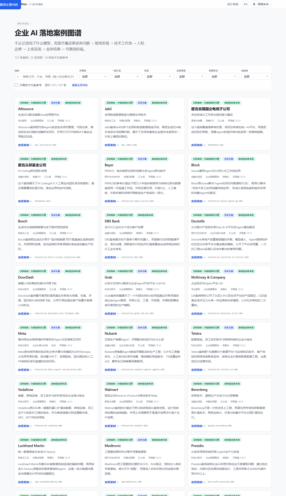
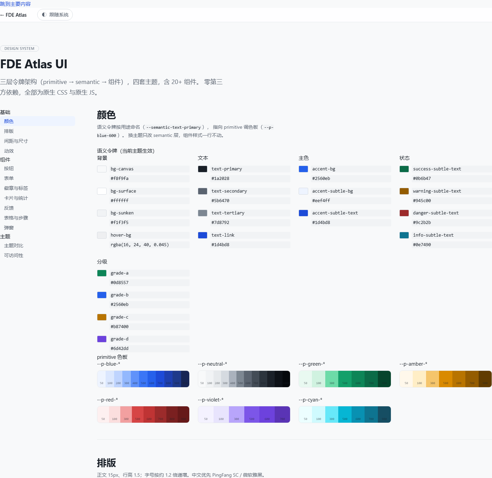

# FDE Atlas · 企业 AI 落地案例图谱

> 不止记录用了什么模型，而是尽量还原完整交付链路：
> **业务问题 → 现场发现 → 技术工作流 → 人机边界 → 上线采用 → 业务结果 → 可复用经验**

一个可检索、可核对、可迁移的企业 AI 落地案例库。收录 **127 条**案例（中英双语），
自带一套可复用的 UI 设计系统。**零第三方运行时依赖**。





## 快速开始

```bash
node -v            # 需要 Node.js ≥ 22
npm run build      # 校验数据 + 生成分层数据产物
npm test           # 61 项单元测试
npm run check:page # 页面 / 模块 / UI 系统自检
npm run ci         # 以上全部 + 59 项浏览器集成测试
```

启动本地服务器浏览：

```bash
npm start        # 或任意静态服务器
# 主页     http://127.0.0.1:4191/index.html
# 设计系统 http://127.0.0.1:4191/styleguide.html
```

> **为什么必须用服务器而不是双击 HTML？**
> 本项目使用原生 ES Module，浏览器在 `file://` 协议下会以 CORS 策略拒绝加载模块。
> 这是零依赖方案的已知取舍 —— 部署到 GitHub Pages 完全不受影响，但本地预览需要静态服务器。

## 三层能力

| 层 | 内容 | 规模 |
|---|---|---|
| **数据** | 127 条案例 + 中英双语 + 六维评分 + 证据账本 | 407 KB / 507 KB |
| **应用** | 检索、六维筛选、详情弹窗、运行时 i18n、四主题 | 7 个 ESM 模块 |
| **UI 系统** | 三层令牌 + 20+ 组件 + 可交互 styleguide | 140 令牌 / 158 类 |

## 目录结构

```text
fde-atlas/
├── index.html                  # 应用入口
├── styleguide.html             # 设计系统可视化文档
├── package.json                # 零依赖
├── data/
│   ├── cases.json              # 中文事实源（唯一需人工维护）
│   ├── cases.en.json           # 英文镜像
│   └── case.schema.json        # JSON Schema，被校验器真正使用
├── src/
│   ├── ui/                     # ★ 设计系统（可独立复用）
│   │   ├── index.css           # 入口，定义层叠顺序
│   │   ├── tokens/
│   │   │   ├── primitive.css   # 原始调色板与尺度（140 个令牌）
│   │   │   └── semantic.css    # 用途映射 × 4 套主题（54 个令牌）
│   │   ├── base/reset.css      # reset 与全局排版
│   │   ├── components/
│   │   │   ├── controls.css    # 按钮/输入/选择/开关
│   │   │   ├── display.css     # 徽章/卡片/统计/空态/骨架/提示
│   │   │   └── composite.css   # 弹窗/表格/选项卡/步骤/评分条
│   │   └── utilities/          # 工具类（克制使用）
│   ├── core/
│   │   ├── taxonomy.js         # 受控词表（维度/证据等级/直接性/成熟度）
│   │   ├── rubric.js           # 六维评分引擎（Node 与浏览器共用）
│   │   ├── search.js           # 索引与筛选（纯函数，可分层富化）
│   │   ├── data-loader.js      # 分层数据按需加载
│   │   ├── url-state.js        # 筛选状态 ↔ URL query
│   │   └── dom.js              # 转义/批量挂载/防抖
│   ├── views/render.js         # 卡片与详情渲染
│   ├── i18n/{index,zh,en}.js   # 运行时国际化
│   ├── main.js                 # 应用入口
│   ├── styleguide.js           # 设计系统页面逻辑
│   └── styles/app.css          # 仅本应用的布局
├── scripts/
│   ├── validate.mjs            # 数据校验三层：schema + 跨字段 + 集合
│   ├── build.mjs               # 生成 7 个分层产物
│   ├── check-page.mjs          # 模块/元素引用/语法/产物自检
│   ├── check-ui.mjs            # ★ 设计系统自检
│   ├── run-browser-tests.mjs   # 无头浏览器 CDP 测试
│   ├── screenshot.mjs / import-upstream.mjs
│   └── lib/schema-validator.mjs# 零依赖 JSON Schema 校验器
├── tests/
│   ├── harness.mjs / suite.mjs # 61 项单元测试
│   └── browser/index.html      # 59 项浏览器断言
├── dist/                       # 构建产物（提交进仓库）
└── docs/
```

---

## 核心设计

### 1. 事实与派生严格分离

`data/cases.json` 只保存人工维护的事实字段。以下字段全部由**构建期计算**：

| 派生字段 | 来源 |
|---|---|
| `detail_score` / `detail_level` | 六维评分引擎 |
| `detail_dimensions` / `missing_details` | 六维评分引擎 |
| `evidence_label` | `evidence_level` + `directness` |

改进正文后不需要"回写分类"，也不可能出现"评分规则改了但数据里的分类还是旧的"——
上游项目为此专门维护了 `npm run classify:detail` 和一条名为"详细度分类已过期"的校验错误。

校验器会主动拒绝在事实数据里出现派生字段。

### 2. 受控词表必须语言中立

`source_record.directness` 最初用中文短语做键，结果英文数据存的是
`"Direct sources at the case level"`，schema 校验直接报出 **127 条错误**。

现在存语言中立的技术值（`case_level` / `aggregate` / ...），标签在 i18n 层解析：

```js
t.directness('case_level')  // → "案例级直接来源" / "Direct case-level source"
```

中英数据因此能共用同一份 schema，并被交叉校验强制一致。

### 3. 分层加载：首屏减少 89%

按实测的字段体积分布拆分：

| 层 | 内容 | 大小 | 加载时机 |
|---|---|---|---|
| `atlas.stats.js` | 统计，两语言共用 | 1 KB | 同步 |
| `atlas.core.js` | 卡片字段 + 评分 | **107 KB** | 同步 |
| `atlas.search.js` | 检索字段 | 214 KB | 首次输入搜索词 |
| `atlas.detail.js` | 详情正文 | 115 KB | 打开案例详情 |

**首屏 107 KB vs 全量 973 KB，减少 89%。**
检索层到达后调用 `enrichIndex()` 原地升级索引，用户几乎无感。

### 4. Schema 真正生效

上游写了 `case.schema.json` 但**没有任何脚本引用它**，校验规则全手写在
`build-data.mjs` 里，两者已经漂移。

本项目实现零依赖 JSON Schema 子集校验器，且：

- 遇到未实现的关键字（`oneOf`、远程 `$ref`）**直接抛错**，不静默放过；
- 长度检查按 Unicode码点计数（中文不算两个字符）；
- `$ref` 与同级关键字并存时不提前返回（否则 `additionalProperties: false` 会被跳过）。

### 5. 运行时 i18n 取代字符串替换

上游用 **157 条 `replaceAll`** 从中文页生成英文页。`replaceAll` 找不到匹配时静默失败——
改一句中文，英文页就悄悄留着中文，而 CI 只检查"页面包含某些标记"，根本发现不了。

现在改为单页 + 查表：`check-page.mjs` 断言中英 key 完全一致，漏翻译直接构建失败。

### 6. URL 状态同步

筛选条件进 query string（用短参数名 `q`/`d`/`e`/`i`/`s`/`m`/`t`/`d2`）：

- 筛选结果可直接分享；
- 浏览器前进/后退能回到上一个筛选；
- 默认状态不产生任何 query，链接保持干净。

---

## UI 设计系统

`src/ui/` 是一个独立可复用的设计系统，任何项目引入即可获得一致外观。

### 三层令牌架构

```
primitive（原始决策）→ semantic（用途映射）→ 组件
  --p-blue-600          --semantic-accent-bg     .ui-button--primary
  "主色就是蓝 600"      "主色用来做按钮背景"
```

分层规则**只对颜色成立**：间距/字号/圆角/动效在四个主题里取值相同，
让它们绕道 semantic 只会把 semantic 变成 primitive 的镜像，多一层间接却换不来主题灵活性。
`scripts/check-ui.mjs` 自动强制这条规则。

### 四套主题

| 主题 | 说明 |
|---|---|
| `light` / `dark` | 常规亮暗，通过 `prefers-color-scheme` 自动跟随 |
| `contrast` | **高对比度**：去掉所有半透明叠加、边框加粗至 2px，正文对比达 WCAG AAA |
| `system` | 跟随系统 |

`check-ui.mjs` 会断言四个主题必须定义**同一组** semantic 令牌——
漏一个就意味着该主题下这个属性会静默回退到light 的值。

### 组件清单

| 组 | 组件 |
|---|---|
| 控件 | Button（6 variant × 3 size）、IconButton、Field、Input、Search、Select、Checkbox、Radio、Switch |
| 标识 | Badge（5 语气 + 4 分级）、Tag（可选中/可删除） |
| 容器 | Card、Stat、Empty、Skeleton、KeyValue、Source、Prose |
| 浮层 | Modal、Toast、Tooltip、Alert |
| 数据 | Table、Tabs、Steps、ScoreBar |

### 可访问性

| 能力 | 实现 |
|---|---|
| 键盘导航 | `:focus-visible` 焦点环（鼠标点击不显示） |
| 跳转链接 | `.ui-skip-link`，Tab 首项即到主内容 |
| 焦点陷阱 | 弹窗内 Tab 循环，关闭后焦点归还触发元素 |
| 减少动效 | `prefers-reduced-motion` 下所有动画降至 80ms |
| 强制颜色 | `forced-colors` 下移除阴影，避免与系统配色冲突 |
| 装饰元素 | 骨架屏、分隔点标记 `aria-hidden` |

### 打开 styleguide

`styleguide.html` 从**计算样式**读取真实生效的令牌值（而不是硬编码一份副本），
因此令牌改了页面会跟着变，文档不会变成第二事实源。
色板、排版刻度、主题对比表都是实时渲染的。

---

## 测试与自检

```bash
npm test               # 61 项单元测试
npm run check:page     # 模块导出 / 元素引用 / JS 语法 / 产物结构
npm run test:browser   # 59 项浏览器集成测试（需本机 Edge/Chrome）
```

| 检查 | 覆盖 |
|---|---|
| `validate.mjs` | schema 结构 + 跨字段一致性 + 集合规则 + 模板化检测 |
| `check-page.mjs` | 模块可加载且导出预期符号、JS 语法、元素 ID 引用、7 个数据层结构对齐、i18n key 完整 |
| `check-ui.mjs` | 令牌完整性、颜色分层约束、四主题覆盖、组件清单、类名定义与使用一致性 |
| `suite.mjs` | 六维评分逐条规则、校验器正反例、搜索筛选、URL 往返、数据完整性 |
| `browser` | 真实 DOM 渲染、XSS 转义、三主题令牌、CSSOM 规则数、令牌真实消费 |

### 自检机制拦下过的真实缺陷

这些都是"单测全绿但功能是坏的"：

| 缺陷 | 为什么单测没抓到 |
|---|---|
| `search.js` 读 `detail.detail_score`，`buildIndex` 输出 `detail.score` → **分数差恒为 NaN，排序静默退化成只按 id 排** | 单测比较的是字符串字段，分数差为 0 时同样落到 id 分支，看起来正常 |
| 三个 CSS 文件以 `/**` 开头 → 浏览器**整份丢弃样式表** | 没有任何 CSS 语法检查 |
| `styleguide.js` 普通函数里用顶层 `await` → SyntaxError，**整个文件静默不执行** | 该文件不被任何单测加载 |
| `$('demoModalClose')` 绑定到不存在的元素 → 按钮点了没反应 | 绑定不存在的元素不报错 |
| `ui-row--lg` 用了但没定义 | 类名缺失在 HTML 里不报错，只是没样式 |
| 测试页 `<link href="../src/...">` → 实际请求 `/tests/src/...` | 页面自检不检查测试页 |

修完后每一条都补了对应的回归断言。

---

## 数据与证据方法

详细度与证据等级是**两套独立维度**：

- **详细度**（满分 12 分，六维各 0–2 分）：业务背景、改造流程、技术工作流、
  人机与治理、量化结果、来源可定位性。≥10 深度，≥7 标准，其余概览。
- **证据等级**：A 案例级直接来源 / B 官方汇总来源 / C 可信二次材料 / D 线索待核验。

证据等级衡量的是**来源能否被定位和复核**，不等于真实性评分。
当前 127 条案例中已记录独立核验的为 **0 条** —— 这个数字应当作待改进项看，不是卖点。

每条案例都记录 `analysis_boundary`，逐字段标注内容是公开披露、结构化整理还是编辑推演。

详见 [METHODOLOGY.md](METHODOLOGY.md)。

## 已知数据债务

构建时输出告警，它们是**待改进项而非错误**：

| 债务 | 现状 |
|---|---|
| 模板化内容 | 14 组 `architecture` 完全相同（最大一组 14 次） |
| 来源链接复用 | 11 条案例共用 `palantir.com/new-homepage/` |
| 独立核验缺失 | 0 / 127 |
| 架构推演未标注 | 76 条案例的架构含编辑推演但核验记录未提示 |

## 许可

原创代码、结构化数据与编辑内容采用 [MIT License](LICENSE)。
案例引用的第三方商标、原始文章、图片与报告仍归各自权利人所有。

## 2026-10-12 运行与发布修复

- 修复详情分层数据的字典读取、直接打开详情缺少正文、语言往返索引和 URL 初始化筛选。
- 异步详情请求按语言和请求序号隔离，关闭／翻页不再覆盖当前结果，焦点返回原始卡片。
- 构建去除每日变化字段；校验失败不再先覆盖有效 manifest。
- CI 显式安装 Chrome，缺浏览器判失败；新增真实入口回归。
- `npm start` 固定监听本机 4191，个人网站继续使用 4190。占用时明确报错，不自动换端口。
- `npm run build:pages` 生成 `.site/` 静态发布目录，支持 GitHub Pages 仓库子路径。

来源说明：基于 FDE-case-library 的案例资料和方法迭代；127 条为公开案例整理量，独立核验数仍为 0，不表示作者完成过这些企业交付。
